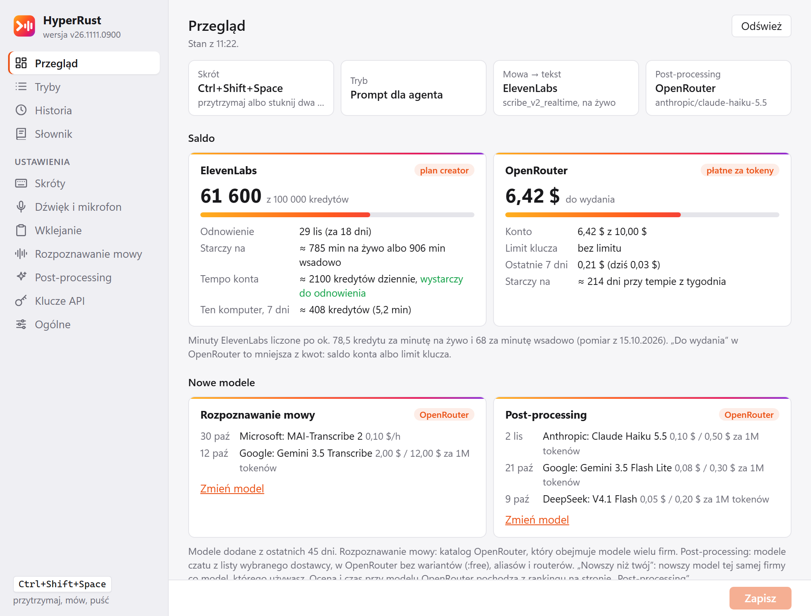
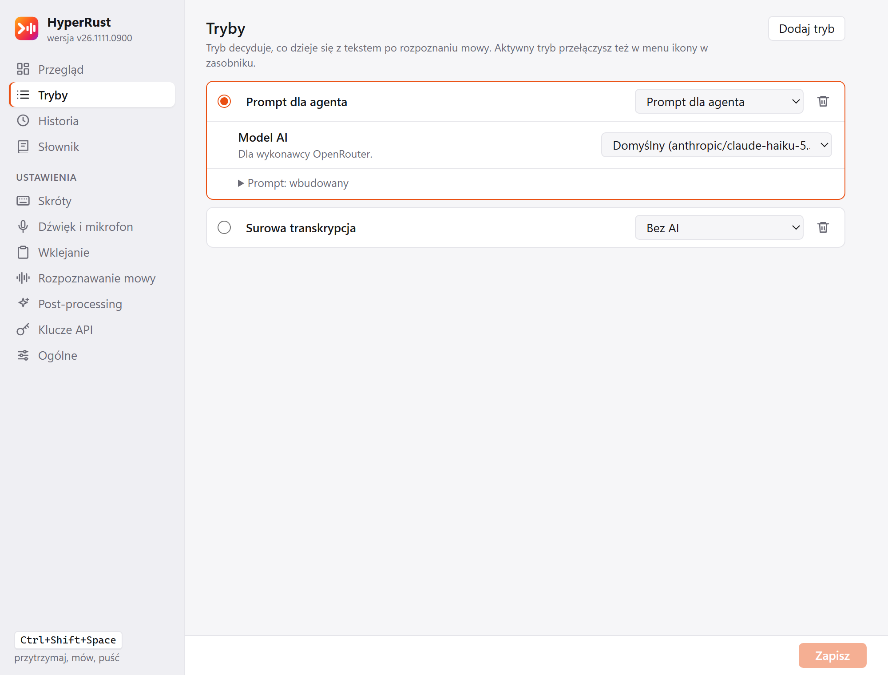
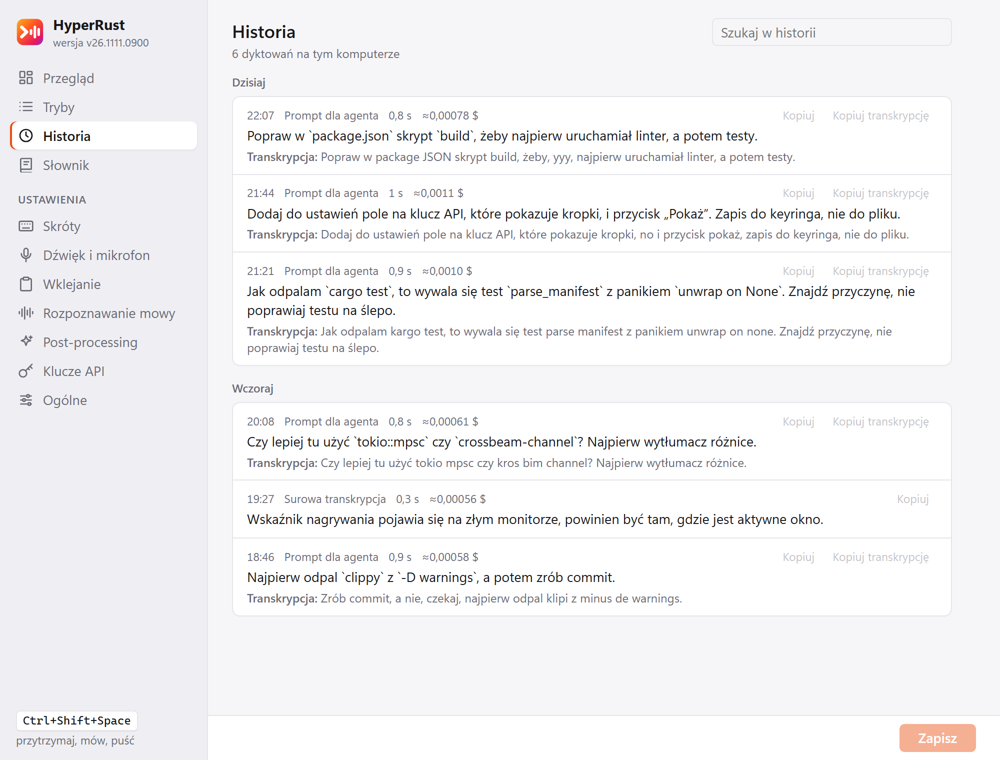
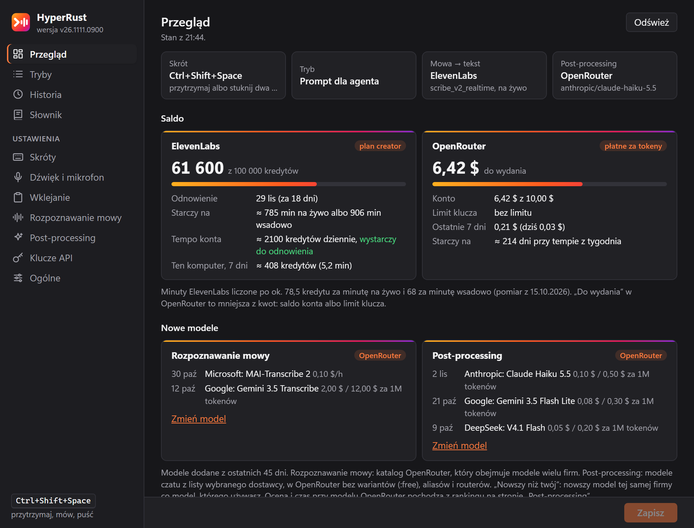

<p align="center">
  
</p>

<h1 align="center">HyperRust</h1>

<p align="center">
  <b>Dyktowanie promptów dla agentów AI na Windows, napisane w Rust.</b><br>
  Przytrzymujesz skrót, mówisz, puszczasz, a tekst ląduje w aktywnym oknie po ćwierć sekundy.
</p>

<p align="center">
  
  
  
</p>

<p align="center">
  
  <br><sub>Wszystkie zrzuty pokazują dane demonstracyjne (zmyślone dyktowania i salda).</sub>
</p>

> **English in short:** a fast push-to-talk dictation app for Windows, written in Rust with
> Tauri 2. Hold a key, speak, release: the transcript, optionally tidied up by an LLM, is pasted
> into the active window. Audio streams to the speech-to-text service while you speak (ElevenLabs
> Scribe, xAI, OpenAI or OpenRouter), so only ~0.25 s is left after you let go. Modes decide what
> happens to the text, a dictionary fixes names the model gets wrong, and the app tracks your
> provider balances. Single portable EXE, keys in the Windows Credential Manager, Polish UI.

---

## Dlaczego

Dyktowanie poleceń dla Claude Code, Codexa czy ChatGPT jest szybsze niż pisanie, ale tylko wtedy,
gdy narzędzie nie każe czekać. HyperRust robi jedną rzecz: ścieżkę od klawisza do wklejonego tekstu,
z najnowszymi modelami i z naciskiem na czas od puszczenia klawisza. Dźwięk płynie do rozpoznawania
mowy już w trakcie mówienia, więc po puszczeniu klawisza zostaje tylko domknięcie transkrypcji.

```
hook klawiatury (WH_KEYBOARD_LL) → mikrofon (WASAPI, 16 kHz mono, 300 ms sprzed naciśnięcia)
  → STT na żywo (WebSocket) → [post-processing LLM, streaming SSE]
  → schowek + Ctrl+V → przywrócenie poprzedniego schowka
```

## Co potrafi

**Dyktowanie**
- Jeden globalny skrót, domyślnie `Ctrl+Shift+Space`: przytrzymaj (push-to-talk) albo stuknij dwa
  razy (nagrywanie bez trzymania). Może to być sam modyfikator, np. `RightCtrl`. Escape anuluje.
- Krótkie piknięcie na początku i końcu nagrania, wskaźnik nagrywania z poziomem dźwięku, który
  nie zabiera fokusu. Kliknięcie w niego kończy dyktowanie, a w nazwę trybu przełącza tryb.
- Odporność: gdy streaming zawiedzie, to samo nagranie idzie wsadowo; gdy zawiedzie LLM, wkleja
  się surowa transkrypcja. Drugie konto ElevenLabs przejmuje dyktowanie, gdy na pierwszym
  skończą się kredyty.

<p align="center"></p>

**Tryby i post-processing**
- „Bez AI” wkleja transkrypcję od razu, „Porządkowanie tekstu” poprawia interpunkcję
  i wypełniacze, a „Prompt dla agenta” redaguje minimalnie: usuwa „yyy” i samopoprawki, poprawia
  nazwy techniczne („git czekaut” → `git checkout`), a twoich słów i tonu nie rusza.
- Każdy tryb może mieć własny model i prompt. Wykonawca: OpenRouter, dowolny endpoint zgodny
  z OpenAI (np. CLIProxy na subskrypcji), `claude -p` albo `codex exec`.
- Słownik nazw, które rozpoznawanie przekręca (`Claude Code = Cloud Code`): podpowiada je
  ElevenLabs, trafia do promptu i poprawia wklejany tekst także bez AI.
- Ranking modeli post-processingu odświeżany codziennie: każdy nowy model czatu z OpenRouter
  dostaje te same polskie dyktowania, ślepy sędzia ocenia wynik, a tabela pokazuje ocenę, czas
  i koszt. Model z rankingu wybierasz jednym kliknięciem.

<p align="center"></p>

**Przegląd i historia**
- Saldo ElevenLabs i OpenRouter z prognozą, na ile starczy, także w dymku ikony w zasobniku.
- Nowe modele STT i LLM z ostatnich 45 dni, zużycie z 7 i 30 dni, czasy etapów i koszt każdego
  dyktowania.
- Historia dyktowań z wyszukiwarką: surowa transkrypcja obok wklejonego tekstu.

<p align="center"></p>

**Wygląd**
- Jasny i ciemny motyw według ustawień Windows, cały interfejs po polsku.

<p align="center"></p>

## Szybkość

Zmierzone od puszczenia klawisza, 12 s polskiej mowy:

| Konfiguracja | Czas |
|---|---|
| ElevenLabs na żywo, tryb „Bez AI” | 0,21–0,30 s |
| ElevenLabs na żywo + Gemini 3.1 Flash Lite przez OpenRouter | 0,96–1,18 s |
| ElevenLabs na żywo + Haiku 5.5 przez OpenRouter | 1,49–1,75 s |
| Rozpoznawanie i Haiku 5.5, oba przez OpenRouter (bez streamingu) | 2,23–2,49 s |

Wklejenie trwa kilka milisekund. Pełne pomiary, porównanie dostawców i modeli oraz uzasadnienie
domyślnych ustawień: [docs/szczegoly.md](docs/szczegoly.md).

## Pobierz

Gotowy plik EXE jest w [wydaniach](https://github.com/jarx-dev/HyperRusts/releases/latest). Pobierz go
do zapisywalnego folderu, np. `%LOCALAPPDATA%\HyperRust\`, i uruchom, bez instalacji (Windows 10
lub 11, WebView2 jest w systemie). Kolejne wydania program pobiera sam, gdy nic nie dyktujesz.
Plik nie jest podpisany, więc za pierwszym razem Windows może ostrzec przed nieznanym wydawcą:
„Więcej informacji” → „Uruchom mimo to”.

Pierwsze uruchomienie:

1. Otworzą się ustawienia. Na stronie „Klucze API” wpisz klucz [ElevenLabs](https://elevenlabs.io)
   (rozpoznawanie mowy) i [OpenRouter](https://openrouter.ai) (post-processing). Sam OpenRouter też
   wystarczy, wtedy rozpoznawanie jest wsadowe (~1 s dłużej).
2. Przytrzymaj `Ctrl+Shift+Space` w dowolnym polu tekstowym, powiedz coś i puść.
3. Opcjonalnie włącz „Uruchamiaj z Windows” (menu ikony w zasobniku albo strona „Ogólne”).

## Prywatność

- Klucze są wyłącznie w Menedżerze poświadczeń Windows (usługa `HyperRust`), nigdy w pliku
  ustawień. Każdy klucz trafia tylko do swojego dostawcy.
- Nagranie idzie do wybranego dostawcy rozpoznawania mowy, a transkrypcja do wybranego wykonawcy
  post-processingu. Nic więcej nie wychodzi z komputera: historia dyktowań zostaje w
  `%LOCALAPPDATA%\HyperRust\logs\history.jsonl`, a dziennik aplikacji nie zawiera dyktowanego tekstu.
- Ustawienia: `%APPDATA%\HyperRust\settings.json`. Historię wyłączysz na stronie „Ogólne”.

## Budowanie

Potrzebne: Rust (stable), Node.js 22 i pnpm 10.

```sh
pnpm install
pnpm tauri build          # na Windows: src-tauri/target/release/hyperrust.exe
```

Na Linuksie, krzyżowo pod Windows:

```sh
cargo install cargo-xwin
pnpm build
cd src-tauri && cargo xwin build --release --target x86_64-pc-windows-msvc --features tauri/custom-protocol
```

Zwykły build nie aktualizuje się sam. Wydania na GitHubie buduje GitHub Actions (workflow „Wydanie”,
uruchamiany ręcznie z `main`): EXE, `latest.json` dla aktualizacji i atestacja pochodzenia pliku.
Każdy PR przechodzi testy, clippy i build na Windows (workflow „build”).

Własny serwer w sieci Tailscale (aktualizacje po każdej zmianie, zbieranie historii dyktowań do
strojenia promptu, codzienny ranking modeli post-processingu) jest opcjonalny:
[docs/wlasny-serwer.md](docs/wlasny-serwer.md).

## Struktura

```
src-tauri/crates/core   rdzeń bez Tauri: ustawienia, maszyna stanów skrótu, DSP audio, dostawcy STT,
                        post-processing, słownik, pomiar czasów, aktualizacje, saldo, ranking
                        (testy na nagranych odpowiedziach w tests/fixtures)
src-tauri/src           aplikacja: hook klawiatury, mikrofon (cpal), wklejanie, wskaźnik, zasobnik, updater
src/, *.html            okno ustawień i wskaźnik nagrywania (TypeScript bez frameworka, Vite)
scripts/                własny serwer (aktualizacje, historia, ranking) i zrzuty do README
```

- Testy i lint: `cd src-tauri && cargo test --workspace && cargo clippy --workspace --all-targets -- -D warnings`,
  frontend: `pnpm build` (z `tsc --noEmit`). Hook `.githooks/pre-push` uruchamia to samo
  (`git config core.hooksPath .githooks`).
- Narzędzia w `src-tauri/crates/core/examples/`: `smoke` (cała ścieżka na pliku WAV), `llm_bench`,
  `prompt_eval`, `catalog`, `balance`, `ranking`. Opis w [docs/szczegoly.md](docs/szczegoly.md).
- Ręczny test na Windows: [docs/windows-manual-test.md](docs/windows-manual-test.md).

## O autorze

HyperRust napisał **Jarosław Hartwich** ([github.com/jarx-dev](https://github.com/jarx-dev)).
To samo znajdziesz w programie: strona „Ogólne” → „O programie”.

Jeśli HyperRust Ci się przydaje, możesz [postawić mi kawę](https://buymeacoffee.com/jarx) ☕


## Licencja

[MIT](LICENSE). Kod możesz używać, zmieniać i rozpowszechniać, także komercyjnie.
