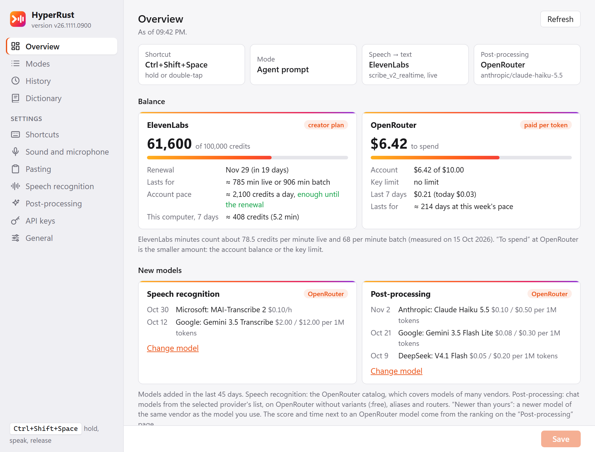
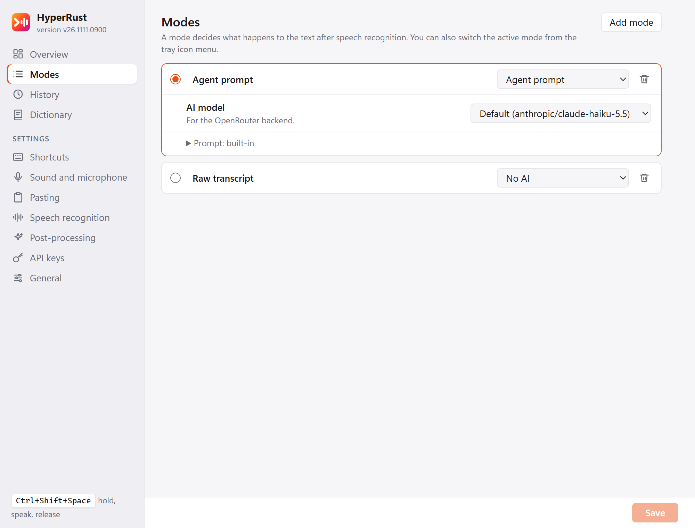
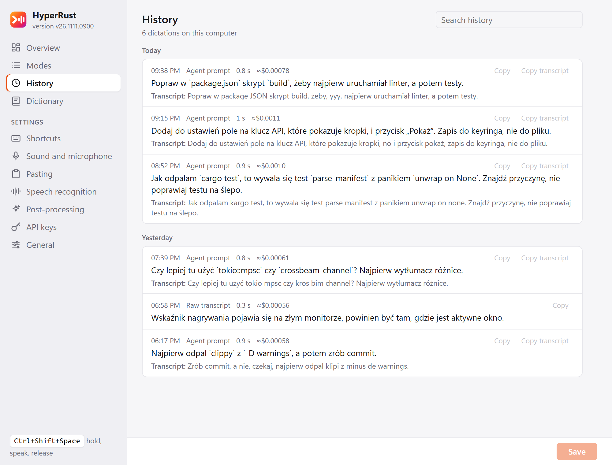
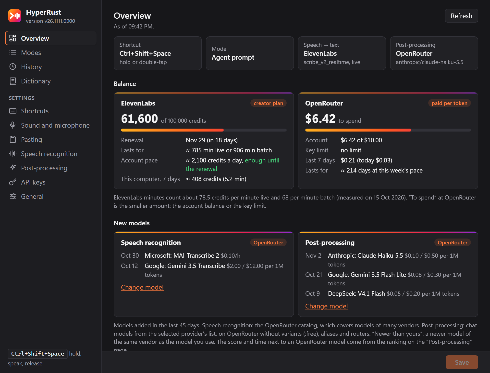
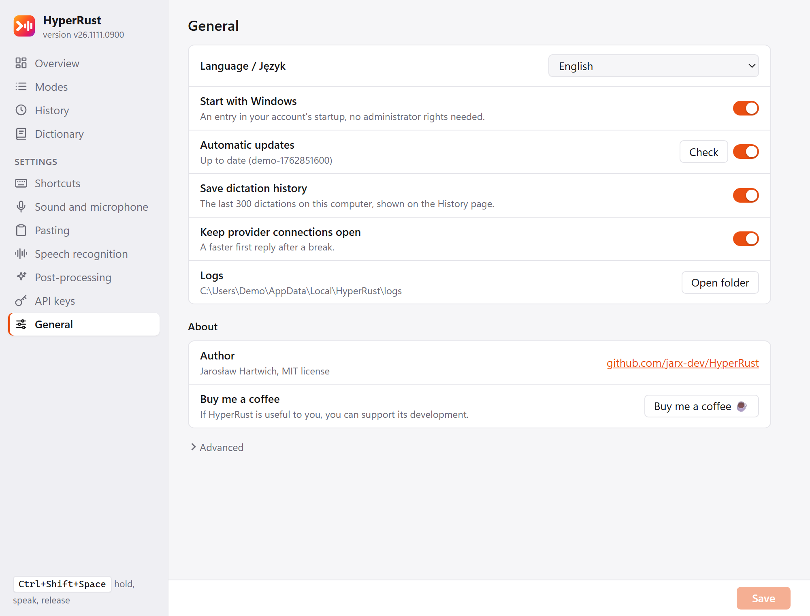

<p align="center">
  <b>English</b> | <a href="README.pl.md">Polski</a>
</p>

<p align="center">
  
</p>

<h1 align="center">HyperRust</h1>

<p align="center">
  <b>Dictation for AI agent prompts on Windows, written in Rust.</b><br>
  Hold a hotkey, speak, let go, and the text lands in the active window a quarter of a second later.
</p>

<p align="center">
  <b><a href="https://github.com/jarx-dev/HyperRust/releases/latest">Download the latest version</a></b>
</p>

<p align="center">
  
  
  
</p>

<p align="center">
  
  <br><sub>All screenshots show demo data (made-up dictations and balances).</sub>
</p>

> The interface is in English or Polish: new installations start in English, and „Ogólne” (General) → Language / Język switches it. The screenshots show the English interface; the labels quoted below are the Polish ones, with the English label in parentheses on first use.

---

## Why

Dictating commands to Claude Code, Codex or ChatGPT is faster than typing, but only if the tool
doesn't make you wait. HyperRust does one thing: the path from keypress to pasted text, with the
latest models and a focus on the time after you release the key. Audio streams to the
speech-to-text service while you are still speaking, so all that is left after you let go is
finishing the transcription.

```
keyboard hook (WH_KEYBOARD_LL) → microphone (WASAPI, 16 kHz mono, 300 ms from before the keypress)
  → live STT (WebSocket) → [LLM post-processing, SSE streaming]
  → clipboard + Ctrl+V → restore the previous clipboard
```

## Features

**Dictation**
- One global hotkey, `Ctrl+Shift+Space` by default: hold it (push-to-talk) or double-tap it
  (recording without holding). It can be a lone modifier, e.g. `RightCtrl`. Escape cancels.
- A short beep at the start and end of the recording, and a recording indicator with a level meter
  that doesn't steal focus. Click it to finish dictating, or click the mode name to switch modes.
- Resilience: if streaming fails, the same recording is sent as a batch; if the LLM fails, the raw
  transcript is pasted. A second ElevenLabs account takes over dictation when the first one runs
  out of credits.

<p align="center"></p>

**Modes and post-processing**
- „Bez AI” (No AI) pastes the transcript as is, „Porządkowanie tekstu” (Text cleanup) fixes
  punctuation and filler words, and „Prompt dla agenta” (Agent prompt) edits minimally: it removes
  "um"s and self-corrections and fixes technical names ("git check out" → `git checkout`), but
  leaves your words and tone alone.
- Each mode can have its own model and prompt. The backend can be OpenRouter, any
  OpenAI-compatible endpoint (e.g. CLIProxy on a subscription), `claude -p` or `codex exec`.
- A dictionary of names that speech recognition tends to mangle (`Claude Code = Cloud Code`): it is
  passed to ElevenLabs as a hint, added to the prompt, and used to fix the pasted text even
  without AI.
- A ranking of post-processing models, refreshed daily: every new OpenRouter chat model gets the
  same Polish dictations, a blind judge scores the output, and the table shows score, time and
  cost. You pick a model from the ranking with one click.

<p align="center"></p>

**Overview and history**
- ElevenLabs and OpenRouter balances with a forecast of how long they will last, also in the
  tooltip of the tray icon.
- New STT and LLM models from the last 45 days, usage over 7 and 30 days, stage timings and the
  cost of each dictation.
- Dictation history with search: the raw transcript next to the pasted text.

<p align="center"></p>

**Appearance**
- Light and dark theme following the Windows setting; the interface in English or Polish.

<p align="center"></p>

## Speed

Measured from the moment the key is released, with 12 s of Polish speech:

| Setup | Time |
|---|---|
| ElevenLabs live, „Bez AI” (No AI) mode | 0.21–0.30 s |
| ElevenLabs live + Gemini 3.1 Flash Lite via OpenRouter | 0.96–1.18 s |
| ElevenLabs live + Haiku 5.5 via OpenRouter | 1.49–1.75 s |
| Recognition and Haiku 5.5, both via OpenRouter (no streaming) | 2.23–2.49 s |

Pasting takes a few milliseconds. Full measurements, a comparison of providers and models, and the
reasoning behind the defaults (in Polish): [docs/szczegoly.md](docs/szczegoly.md).

## Download

The ready-made EXE is on the [releases page](https://github.com/jarx-dev/HyperRust/releases/latest).
Download it to a writable folder, e.g. `%LOCALAPPDATA%\HyperRust\`, and run it; there is no
installer (Windows 10 or 11, WebView2 is part of the system). The app downloads later releases
itself when you are not dictating. The file is not signed, so the first time Windows may warn about
an unknown publisher: „Więcej informacji” (More info) → „Uruchom mimo to” (Run anyway).

First run:

1. The settings open. On the „Klucze API” (API keys) page, enter your [ElevenLabs](https://elevenlabs.io)
   key (speech recognition) and your [OpenRouter](https://openrouter.ai) key (post-processing).
   OpenRouter alone is enough too, but then recognition is batch (~1 s slower).
2. Hold `Ctrl+Shift+Space` in any text field, say something and let go.
3. Optionally turn on „Uruchamiaj z Windows” (Start with Windows), in the tray icon menu or on the
   „Ogólne” (General) page.

## Privacy

- Keys are stored only in the Windows Credential Manager (service `HyperRust`), never in the
  settings file. Each key goes only to its own provider.
- The recording goes to the speech-recognition provider you chose, and the transcript goes to the
  post-processing backend you chose. Nothing else leaves your computer: dictation history stays in
  `%LOCALAPPDATA%\HyperRust\logs\history.jsonl`, and the application log contains no dictated text.
- Settings: `%APPDATA%\HyperRust\settings.json`. You can turn history off on the „Ogólne” (General)
  page.

## Building

You need Rust (stable), Node.js 22 and pnpm 10.

```sh
pnpm install
pnpm tauri build          # on Windows: src-tauri/target/release/hyperrust.exe
```

On Linux, cross-compiling for Windows:

```sh
cargo install cargo-xwin
pnpm build
cd src-tauri && cargo xwin build --release --target x86_64-pc-windows-msvc --features tauri/custom-protocol
```

A regular build does not update itself. GitHub releases are built by GitHub Actions (the „Wydanie”
(Release) workflow, run manually from `main`): the EXE, `latest.json` for updates, and a build
provenance attestation for the file. Every PR goes through tests, clippy and a Windows build (the
„build” workflow).

Your own server on a Tailscale network (updates after every change, collecting dictation history
to tune the prompt, a daily ranking of post-processing models) is optional:
[docs/wlasny-serwer.md](docs/wlasny-serwer.md).

## Structure

```
src-tauri/crates/core   core without Tauri: settings, hotkey state machine, audio DSP, STT providers,
                        post-processing, dictionary, timing measurement, updates, balance, ranking
                        (tests run on recorded responses in tests/fixtures)
src-tauri/src           the app: keyboard hook, microphone (cpal), pasting, indicator, tray, updater
src/, *.html            settings window and recording indicator (TypeScript, no framework, Vite)
scripts/                your own server (updates, history, ranking) and README screenshots
```

- Tests and lint: `cd src-tauri && cargo test --workspace && cargo clippy --workspace --all-targets -- -D warnings`,
  frontend: `pnpm build` (with `tsc --noEmit`). The `.githooks/pre-push` hook runs the same
  (`git config core.hooksPath .githooks`).
- Tools in `src-tauri/crates/core/examples/`: `smoke` (the whole path on a WAV file), `llm_bench`,
  `prompt_eval`, `catalog`, `balance`, `ranking`. Described in [docs/szczegoly.md](docs/szczegoly.md).
- Manual test on Windows: [docs/windows-manual-test.md](docs/windows-manual-test.md).

## About the author

HyperRust was written by **Jarosław Hartwich** ([github.com/jarx-dev](https://github.com/jarx-dev)).
You can find the same in the app: the „Ogólne” (General) page → „O programie” (About).

If you find HyperRust useful, you can [buy me a coffee](https://buymeacoffee.com/jarx) ☕



## License

[MIT](LICENSE). You may use, modify and distribute the code, including commercially.
